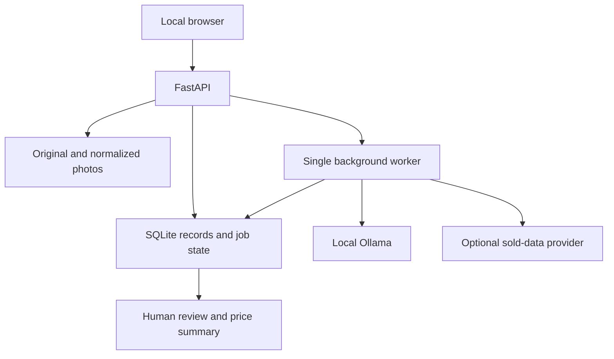

# Vintagecat

A private garment-research workspace: upload photos once, review AI identification, attach comparable sales, and save an editable catalogue record.

**Current milestone: local research prototype, not a finished cross-listing product.** No marketplace posting, account connections, automatic sale synchronization or authentication of clothing is implemented. No subscription is purchased by this app.

**Building it hands-on? Start with `docs/LEARNING.md`.** The complete application above is an assistant-built reference, not a claim that you implemented or mastered it. The separate `learning/` starter lets you write the core pieces yourself, one checkpoint at a time.

## Start on your PC or Mac

Requires Python 3.12 and a modern browser. Install [Python](https://www.python.org/downloads/) and, for image analysis, [Ollama](https://ollama.com/download). The catalogue and manual comps work without Ollama or paid services.

Extract this project into a normal local folder. Open a terminal in that folder, alongside this README.

### Mac

```bash
python3 -m venv .venv
.venv/bin/python -m pip install -r requirements.txt
cp config.example.toml config.local.toml
.venv/bin/python -m uvicorn app.main:app --host 127.0.0.1 --port 8000
```

### Windows (PowerShell)

```powershell
py -3.12 -m venv .venv
.\.venv\Scripts\python.exe -m pip install -r requirements.txt
Copy-Item config.example.toml config.local.toml
.\.venv\Scripts\python.exe -m uvicorn app.main:app --host 127.0.0.1 --port 8000
```

Open **http://127.0.0.1:8000**. Keep the terminal running. On later launches, run only the final uvicorn command. Stop with Ctrl+C. Do not use `--reload` while research jobs are running, and run one server worker only.

### Connect local image analysis

Run Ollama, then in a separate terminal:

```bash
ollama pull qwen3-vl:8b
```

The initial model is a candidate, not a proven best model for clothing. Start evaluation on the RTX 5080 PC. For the M2 Mac, you can try `ollama pull qwen3-vl:4b` and change `model` to `qwen3-vl:4b` in `config.local.toml`; restart Vintagecat afterward. Both models are vision-capable options in the Ollama library. Performance and quality on your machines have not been benchmarked.

In the app, open **Connections → Check model connection**. Your model must be downloaded before identification works. Ollama must be running; `ollama serve` starts it if the desktop service is not already running. A duplicate-port error generally means it is already running.

For now, run a separate local instance on either computer. They do not automatically share a catalogue. A secure shared server or private tunnel is a later milestone; do not expose unauthenticated Ollama or Vintagecat to the public internet. To move the catalogue between computers, stop both instances and copy the complete `data` folder to the destination (back up the destination first).

## First garment: the complete workflow

1. Select **New garment**.
2. Add front, back, brand tag, care/style tag, and flaw photos. JPG, PNG or WebP, at most 12 photos, 15 MB each, 70 MB per upload batch. Convert iPhone HEIC first. You can add more photos later and reorder them.
3. Select **Identify with local AI**. The request runs in a background job. The model receives all normalized photos in their visible order. Photo-text is treated as evidence, not instructions.
4. Read the observations. Copy suggestions into the form, correct them, and **Save details**. AI does not overwrite your record. Certainty labels are subjective model opinions, not calibrated probabilities or authenticity decisions.
5. Attach comps you researched, or enable the optional provider below. For each candidate, inspect its source and check **I reviewed this as a comparable garment**. Check actual-amount verification only when you have verified the transaction amount and date.
6. The summary displays the median and observed min/max of reviewed USD sales within 180 days. Asking prices, other currencies, unknown sale dates and unreviewed matches are excluded. Provider-reported rows remain clearly labeled.
7. Optionally request an **AI-only rough range**. This is a separate model guess with no live research. It can decline to produce a number. It never automatically sets an asking price or creates comparable records.
8. Enter your own asking price and cost. Ready/sold statuses are manual tracking labels, not marketplace actions.

Identity edits invalidate comparable match approvals. Changed photos flag previous identification as stale. Changed identity flags an earlier AI-only estimate as stale. Failed research does not overwrite existing comps or assert there are no sales.

## Optional sold-data adapter

The `CompsAPI` adapter implements its publicly documented `/v1/sold` interface. **It has only been tested against mocked responses, not a live account.** Vendor accuracy, garment coverage, Best Offer amounts, and permitted downstream data use remain to be checked. Treat this as an evaluation candidate, not a verified data partnership.

Its docs advertised 100 free requests/month and a $9/month Starter plan on October 17, 2026. Verify current terms and quotas before signing up; no paid plan is needed to begin the prototype.

If you choose to evaluate it, get a key from [the provider console](https://app.compsapi.com/) and put it in your local `config.local.toml`:

```toml
ollama_url = "http://127.0.0.1:11434"
model = "qwen3-vl:8b"
compsapi_key = "YOUR_KEY_HERE"
monthly_search_limit = 80
```

Alternatively set the `COMPSAPI_KEY` environment variable. Do not paste keys in chat, commit them to Git, or include `config.local.toml` in a shared archive. Restart the app after changing configuration.

Each user-triggered query makes at most one provider request for up to 30 US candidates over 90 days. There are no automatic retries or query expansion yet. Identical queries reuse a 24-hour local cache. An application-side monthly cap reserves a request even if it fails, conservatively limiting usage; it is not a dollar-cost guarantee or a provider-wide quota. Changing computers starts a separate local counter, so monitor the provider's quota too.

Provider results are unselected by default. Review model, era, size, condition, lot/bundle status and price. A provider's `price` can represent a multi-unit average; this is flagged when reported. Shipping is stored separately and never silently imputed. The app makes no sell-through, demand, rarity or sale-time predictions.

## Architecture



- `app/main.py`: HTTP routes, same-origin write guard, uploads, job lifecycle.
- `app/store.py`: SQLite transactions, optimistic editing lock, usage counter and cache.
- `app/providers.py`: image-model and sold-data adapters; validated output and redacted errors.
- `app/models.py`: structured identification and evidence schemas.
- `app/pricing.py`: deterministic evidence inclusion and observed-price statistics.
- `app/static/`: buildless responsive HTML/CSS/JavaScript UI; no Node build required.
- `tests/`: API, evidence, persistence, provider failure and job tests.

SQLite and one worker suit this single-user prototype. PostgreSQL, shared object storage, authentication, owner-scoped records, migrations and a durable job worker belong to the future multi-user transition. This version is not multi-tenant ready. Server restart marks queued/running jobs interrupted instead of silently reissuing a paid request.

Original bytes are preserved in `data/photos/*.original`; resized JPEGs have orientation applied and metadata removed. Model analysis uses these resized copies. Original EXIF can still exist in the local originals. Photos are never sent to CompsAPI, only the query text. Manual source URLs are links, not automatically fetched by the app.

## Backups and portability

Stop the app, then copy the **entire `data` folder**. This contains SQLite, source photos, normalized photos, cached research and jobs. The JSON export is a useful readable record but does not include photo bytes and is not currently importable through the UI. No delete feature is included in this first version. Photos and records persist until you remove the local data folder yourself.

## Verification

```bash
# Mac; on Windows substitute .\.venv\Scripts\python.exe
.venv/bin/python -m pip install -r requirements-dev.txt
.venv/bin/python -m pytest -q
```

See `docs/VALIDATION.md` for the actual verification performed. The tests use synthetic fixture images and fake network responses. They prove error-handling contracts and arithmetic, not model accuracy or real provider coverage. A CI workflow is supplied but has not run on your GitHub account.

## What to build next

1. Run your first garment through local Ollama and record the model tag/digest (`ollama list`), settings, latency and corrections in `evaluation/garments.csv`.
2. Check a small provider sample against your own eBay Product Research observations, especially Best Offer transactions, wrong variants and multi-unit records. Store source links and dates; confirm allowed data use before a public release.
3. Evaluate 20–30 labeled workwear/denim garments. Measure field accuracy, retrieval relevance, unsupported statements, cost and human review time. Keep a held-out subset out of prompt tuning.
4. Add listing drafts and the first authorized eBay publishing integration only after research quality is demonstrated.

Sources and provider limitations are recorded in `docs/RESEARCH.md`. No pricing accuracy or time-saving benchmark is claimed yet.
